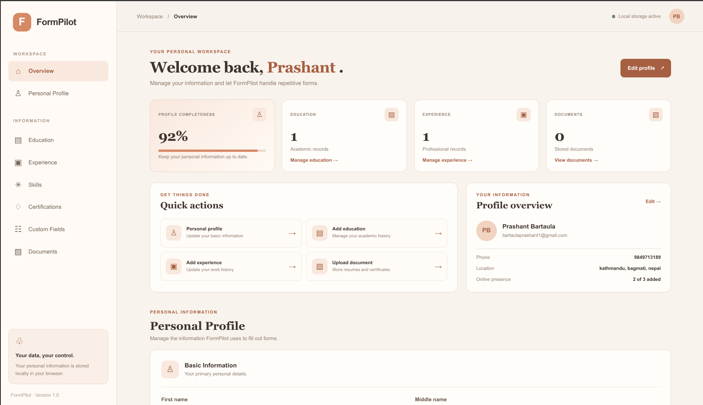
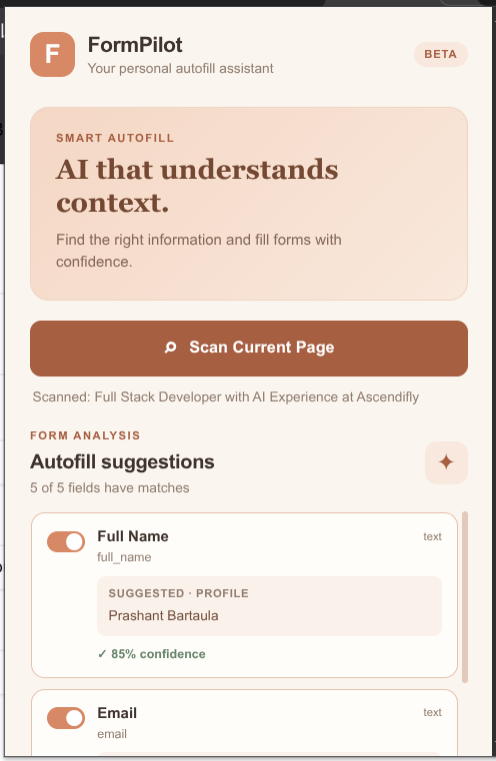
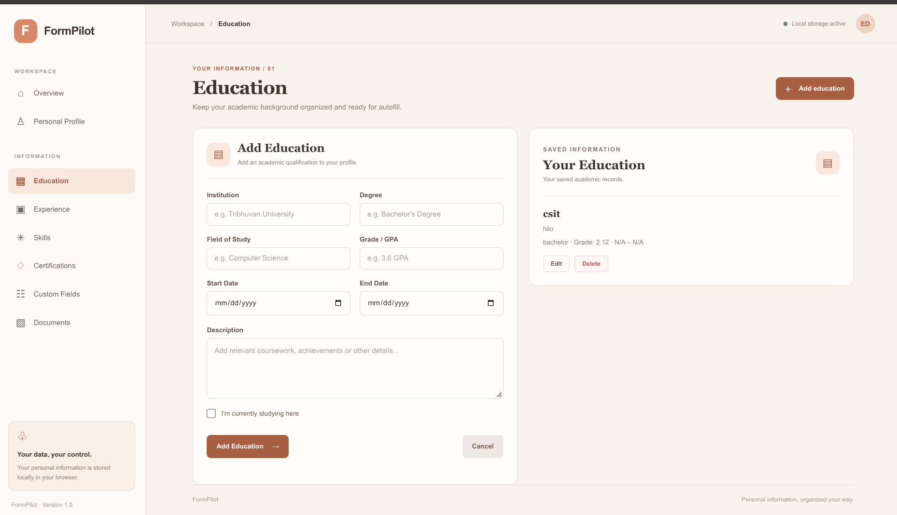
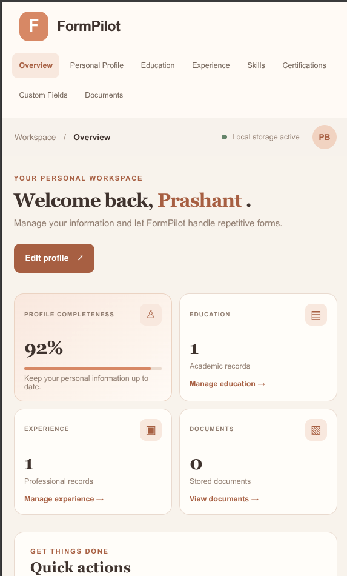

# FormPilot

**Your personal information, organized and ready to use.**

FormPilot is a privacy-focused Chrome extension that stores personal and professional information locally and helps autofill supported online forms.

## Screenshots

| Dashboard | Extension Popup |
|---|---|
|  |  |

| Profile Management | Documents |
|---|---|
|  |  |

## Features

- **Personal Information Management:** Manage personal details, education, experience, skills, and certifications.
- **Form Detection:** Detect supported form fields on webpages.
- **Intelligent Matching:** Match detected fields with stored information.
- **Autofill:** Review suggestions and fill supported form elements.
- **Document Management:** Upload, preview, and manage PDF and image files.
- **Local Storage:** Store information using IndexedDB.

## Technology Stack

- HTML, CSS, JavaScript (ES Modules)
- Chrome Extension Manifest V3
- IndexedDB
- Chrome Scripting and Messaging APIs

## Installation

1. Clone the repository:

   ```bash
   git clone https://github.com/YOUR_USERNAME/FormPilot.git